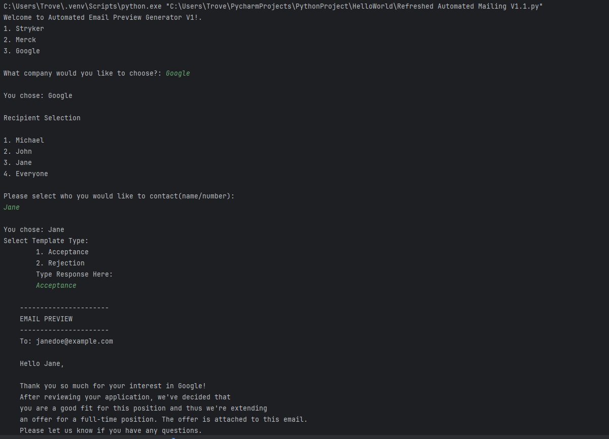
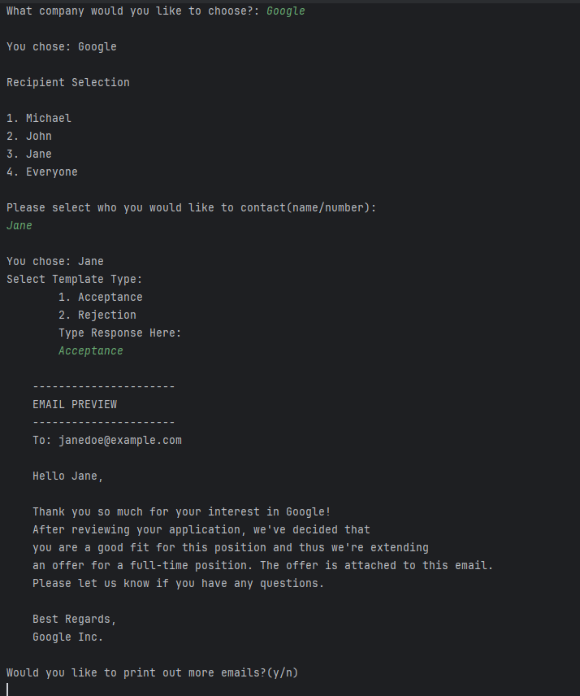

# Automated Email Preview Generator V1

## About the Project
I built this project while I was learning the basics of Python. I wanted to see if I could take what I was learning and use it to build something that would make preparing similar emails for different people easier.

The program lets users choose a company, select recipients, and generate customized email previews using different templates.

## Features
- Select a company by name or number.
- Choose an individual recipient or everyone.
- Choose between acceptance and rejection email templates.
- Generate customized email previews.
- Handle invalid inputs and allow users to try again.

## Challenges
One of the hardest parts of this project was figuring out how to put everything together. I understood some Python concepts individually, but actually applying them to build a working program was a different experience.

At first, I was hard-coding a lot of things. As I became more comfortable with Python, I started breaking the program down into functions and figuring out how to make the different parts work together.

I also spent a lot of time working on input validation. For example, I had to figure out how to handle invalid numbers, unexpected responses, and different ways someone might enter the same option without having the program break.

## How to Run
1. Install Python 3.12 or newer.
2. Download the Python file from this repository.
3. Open a terminal in the folder containing the file.
4. Run:

```bash
python "Automated Mailing V1.1.py"
```

5. Follow the prompts to select a company, recipient, and email template.

## What I Learned
This project helped me become more comfortable with functions, loops, dictionaries, and debugging. One thing I realized was that understanding a programming concept and actually knowing how to use it to solve a problem are two different things.

I also learned how important it is to consider different user inputs instead of assuming everyone will interact with the program the same way.

## Future Improvements
I eventually want to add a feature that actually sends emails instead of just generating previews. I'd also like to allow users to add their own contacts and create their own email templates.

**Note:** This version generates email previews and does not send actual emails.


## Program Screenshots

### Screenshot 1: Program Interface


### Screenshot 2: Generated Email Preview


